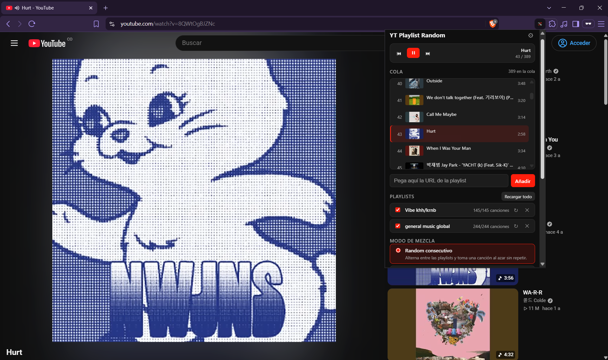
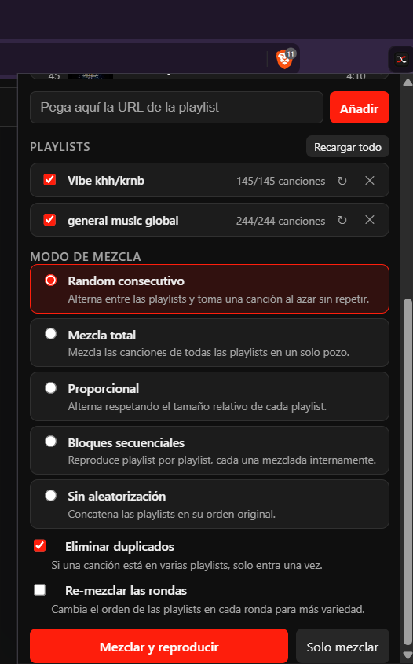
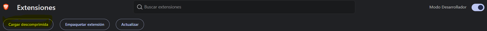
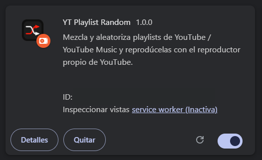

<p align="center">
  
</p>


# Extensión YT Playlist Random (Chrome / Brave)

Mezcla y aleatoriza playlists de **YouTube** y **YouTube Music** y las reproduce con el
**reproductor nativo de YouTube** (no se incluye ningún player propio).


<p align="center">
  
</p>


<p align="center">
  
</p>

Extention mucho mejor que la web: https://yt-playlist-randomizer.vercel.app 

## Funciones

- Pega 1..N URLs de playlist (formatos normales de youtube.com/playlist?list=…, watch?v=…&list=… y music.youtube.com).
- **Modos de mezcla:**
  - **Random consecutivo** — alterna entre playlists, una canción al azar sin repetir.
  - **Mezcla total** — todo en un solo pozo.
  - **Proporcional** — alterna respetando el tamaño relativo de cada playlist.
  - **Bloques secuenciales** — playlist por playlist, cada una mezclada internamente.
  - **Sin aleatorización** — concatenación en el orden original.
- **Eliminar duplicados**: una canción presente en varias playlists entra una sola vez.
- Reproducción con el **reproductor propio de YouTube** (no hay ningún player alternativo):
  - Cada pista se carga navegando la pestaña a su URL nativa `https://www.youtube.com/watch?v=<id>` (o `music.youtube.com`). Recargas completas permitidas; el player de la página es el único que suena.
  - Al terminar una pista se pausa el vídeo al instante y la extensión navega a la siguiente de la cola; nunca suena el «siguiente» sugerido de YouTube.
  - Pausa ▶/⏸ de la MISMA pista no recarga; cambiar de pista sí.
  - Las pistas incompatibles (videos que YT Music no sirve, borrados, con restricción) se detectan con el error real del player o por estar atascada >13s, se marcan `unavailable` y se saltan solas — nunca se salta una pista solo por buffering lento.
- Cola persistente durante la sesión (sobrevive a cerrar el popup); controles ▶ / ⏸ / ⏮ / ⏭ y salto a cualquier pista desde el popup.
- i18n ES/EN automática según el navegador.

## Instalación (desarrollo)
1. Clona el repositorio:
   ```bash
   git clone <this-repo-url>
   ```
2. The app needs a **YouTube Data API v3 key**. It lives in the `.env` file (see `.env.example`):

```bash
YOUTUBE_API_KEY=''
```
3. **Genera `config.js`** (inyecta la clave del `.env`):

   **Windows:**
   ```powershell
   powershell -ExecutionPolicy Bypass -File .\generate-config.ps1
   ```
   **Linux / macOS:**
   ```bash
   bash generate-config.sh        # o ./generate-config.sh (trae permiso de ejecución)
   ```
   (El `.env` se busca únicamente en la carpeta raíz de esta extensión; ambos scripts aceptan la clave con o sin comillas y comentarios en línea. Si tienes PowerShell Core (`pwsh`) instalado en Linux/macOS, `pwsh generate-config.ps1` también funciona.)
   También puedes cambiar la clave más tarde en **Opciones** de la extensión.
3. Abre `brave://extensions` (o `chrome://extensions`), activa **Developer mode** y **Load unpacked**.
 
   <p align="center">
  
</p>

1. Selecciona la carpeta de este repositorio o proyecto `folder`.
   <p align="center">
  
</p>
1. Clic en el ícono: pega URLs, elige el modo y «Mezclar y reproducir».

## Opciones

- **API key** de YouTube Data API v3 (vacío = la clave empaquetada).
- **Sitio de reproducción**: `www.youtube.com` o `music.youtube.com`.
  En YT Music los videos normales a menudo no están en el catálogo: esos saltos son automáticos.

## Quota de API

Cada carga de playlist cuesta:
- `playlistItems` (50 pistas/página) → 1 unidad por página.
- `videos` (duraciones, lotes de 50) → 1 unidad por lote.
- `playlists` (título) → 1 unidad.

Con la cuota diaria por defecto de 10.000 unidades se alcanzan ~50-80 playlists de 100 pistas al día. Las pistas se cachean 5 minutos por playlist (`loadedAt`).

## Limitaciones

- NO se pueden leer: mezclas automáticas (`RD…`), «Liked music»/«Watch later» (`LL`/`WL`) y playlists privadas.
- Cambiar de pista navega la pestaña a la URL nativa (`watch?v=<id>`), o sea que se recarga la página en cada cambio — es la consecuencia de usar el reproductor propio de YouTube sin APIs internas.
- La clave va expuesta en cada petición al navegador (no hay servidor); cámbiala en Opciones si aparece en tus logs.

## Estructura

- `manifest.json` — MV3, `content_scripts` en youtube.com / music.youtube.com.
- `popup.js` + `index.html` + `popup.css` — UI del popup (playlists, modos, cola, controles).
- `background.js` — service worker módulo: cola, índice, búsqueda/creación de pestaña, fallback, mensajes.
- `content.js` — adapter del reproductor nativo dentro de la página de YouTube.
- `lib/shuffle/*` — motores portados 1:1 del proyecto web (`consecutiveRandom`, `fullShuffle`, `proportional`, `sequentialBlocks`, `pools` + `fisherYates`).
- `lib/api.js`, `lib/parseUrl.js`, `lib/errors.js`, `lib/time.js` — API y utilidades.
- `config.js` — generado por `generate-config.ps1` (Windows) o `generate-config.sh` (Linux/macOS) (nunca commitear).


### 📄 License

This project is licensed under the MIT License - see the [LICENSE](LICENSE) file for details.

---

## 👨‍💻 Author / Autor

**Diego Ivan Perea Montealegre**

- GitHub: [@diegoperea20](https://github.com/diegoperea20)

---

Created by [Diego Ivan Perea Montealegre](https://github.com/diegoperea20)