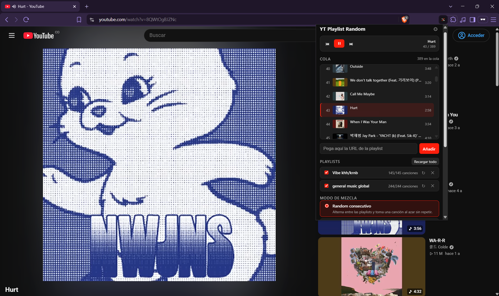
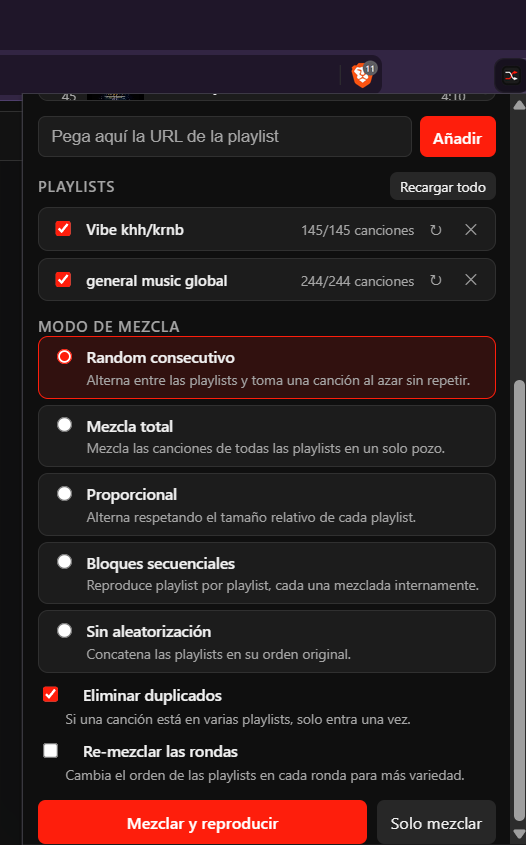
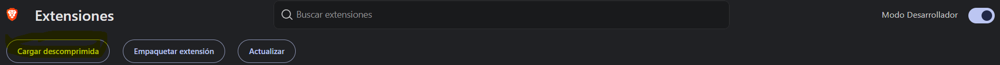
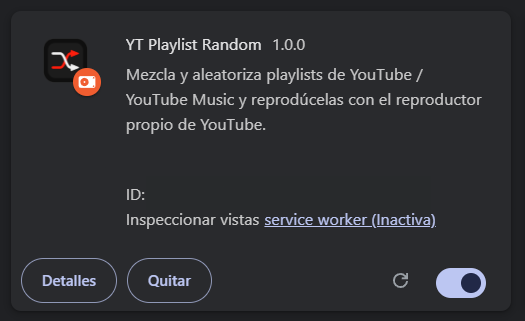

<p align="center">
  
</p>


# YT Playlist Random Extension (Chrome / Brave)

It mixes and shuffles playlists from **YouTube** and **YouTube Music** and plays them with the
**native YouTube player** (no own player is included).


<p align="center">
  
</p>


<p align="center">
  
</p>

Extension much better than the web: https://yt-playlist-randomizer.vercel.app

## Features

- Paste 1..N playlist URLs (normal formats from youtube.com/playlist?list=…, watch?v=…&list=… and music.youtube.com).
- **Shuffle modes:**
  - **Consecutive random** — alternates between playlists, one song at random without repeating.
  - **Full shuffle** — everything in a single pool.
  - **Proportional** — alternates respecting the relative size of each playlist.
  - **Sequential blocks** — playlist by playlist, each one shuffled internally.
  - **No shuffling** — concatenation in the original order.
- **Remove duplicates**: a song present in several playlists enters only once.
- Playback with **YouTube's own player** (there is no alternative player):
  - Each track is loaded by navigating the tab to its native URL `https://www.youtube.com/watch?v=<id>` (or `music.youtube.com`). Full reloads are allowed; the page's player is the only one that plays.
  - When a track ends, the video is paused instantly and the extension navigates to the next one in the queue; YouTube's suggested "next" never plays.
  - ▶/⏸ pause of the SAME track does not reload; changing tracks does.
  - Incompatible tracks (videos that YT Music does not serve, deleted, with restrictions) are detected with the real player error or by being stuck >13s, are marked `unavailable` and are skipped by themselves — a track is never skipped just for slow buffering.
- Queue persistent during the session (survives closing the popup); ▶ / ⏸ / ⏮ / ⏭ controls and jump to any track from the popup.
- Automatic ES/EN i18n according to the browser.

## Installation (development)
1. Clone the repository:
   ```bash
   git clone <this-repo-url>
   ```
2. The app needs a **YouTube Data API v3 key**. It lives in the `.env` file (see `.env.example`):

```bash
YOUTUBE_API_KEY=''
```
3. **Generate `config.js`** (injects the key from the `.env`):

   **Windows:**
   ```powershell
   powershell -ExecutionPolicy Bypass -File .\generate-config.ps1
   ```
   **Linux / macOS:**
   ```bash
   bash generate-config.sh        # or ./generate-config.sh (it comes with execute permission)
   ```
   (The `.env` is looked for only in the root folder of this extension; both scripts accept the key with or without quotes and inline comments. If you have PowerShell Core (`pwsh`) installed on Linux/macOS, `pwsh generate-config.ps1` also works.)
   You can also change the key later in the extension's **Options**.
3. Open `brave://extensions` (or `chrome://extensions`), enable **Developer mode** and **Load unpacked**.
 
   <p align="center">
  
</p>

1. Select the folder of this repository or project `folder`.
   <p align="center">
  
</p>
1. Click on the icon: paste URLs, choose the mode and «Shuffle and play».

## Options

- YouTube Data API v3 **API key** (empty = the bundled key).
- **Playback site**: `www.youtube.com` or `music.youtube.com`.
  On YT Music normal videos are often not in the catalog: those skips are automatic.

## API quota

Each playlist load costs:
- `playlistItems` (50 tracks/page) → 1 unit per page.
- `videos` (durations, batches of 50) → 1 unit per batch.
- `playlists` (title) → 1 unit.

With the default daily quota of 10,000 units, ~50-80 playlists of 100 tracks per day are reached. Tracks are cached 5 minutes per playlist (`loadedAt`).

## Limitations

- CANNOT be read: automatic mixes (`RD…`), «Liked music»/«Watch later» (`LL`/`WL`) and private playlists.
- Changing tracks navigates the tab to the native URL (`watch?v=<id>`), that is, the page reloads on every change — it is the consequence of using YouTube's own player without internal APIs.
- The key is exposed on every request to the browser (there is no server); change it in Options if it appears in your logs.

## Structure

- `manifest.json` — MV3, `content_scripts` on youtube.com / music.youtube.com.
- `popup.js` + `index.html` + `popup.css` — popup UI (playlists, modes, queue, controls).
- `background.js` — module service worker: queue, index, tab search/creation, fallback, messages.
- `content.js` — adapter of the native player inside the YouTube page.
- `lib/shuffle/*` — engines ported 1:1 from the web project (`consecutiveRandom`, `fullShuffle`, `proportional`, `sequentialBlocks`, `pools` + `fisherYates`).
- `lib/api.js`, `lib/parseUrl.js`, `lib/errors.js`, `lib/time.js` — API and utilities.
- `config.js` — generated by `generate-config.ps1` (Windows) or `generate-config.sh` (Linux/macOS) (never commit).


### 📄 License

This project is licensed under the MIT License - see the [LICENSE](LICENSE) file for details.

---

## 👨‍💻 Author

**Diego Ivan Perea Montealegre**

- GitHub: [@diegoperea20](https://github.com/diegoperea20)

---

Created by [Diego Ivan Perea Montealegre](https://github.com/diegoperea20)
